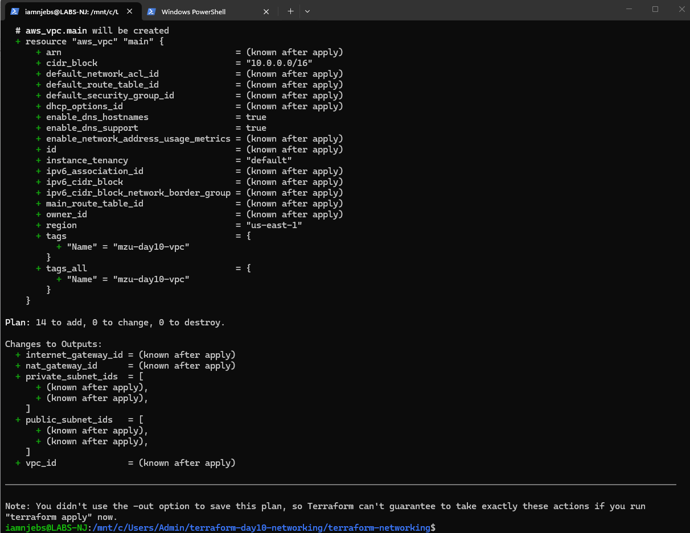
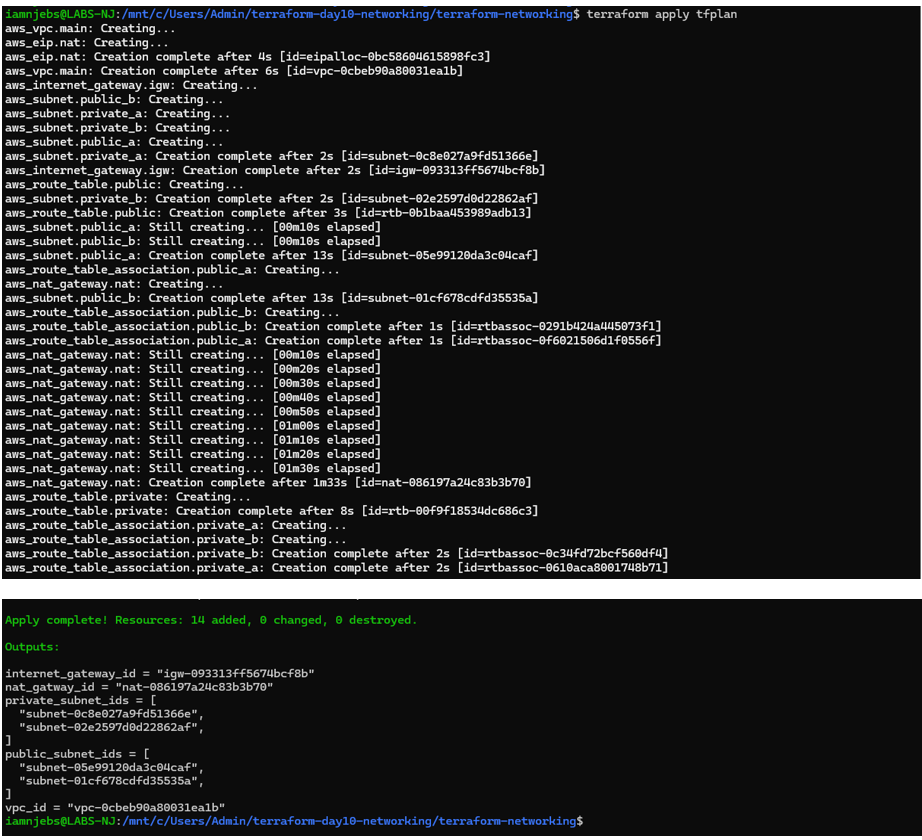
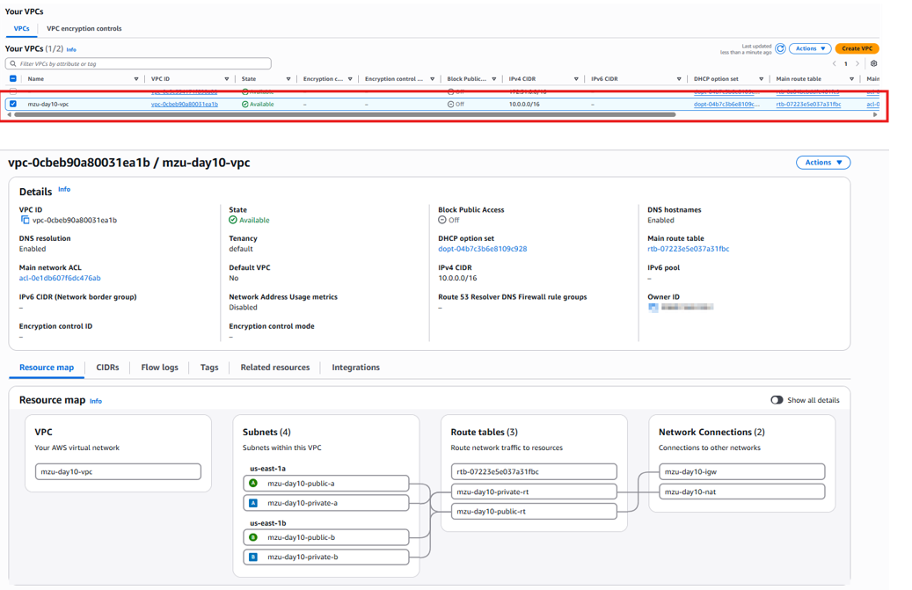
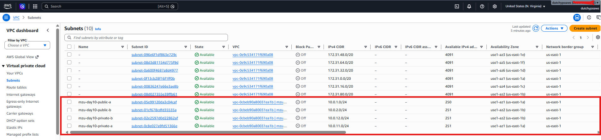
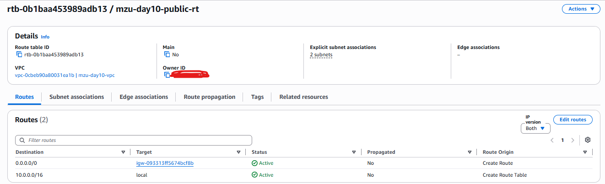
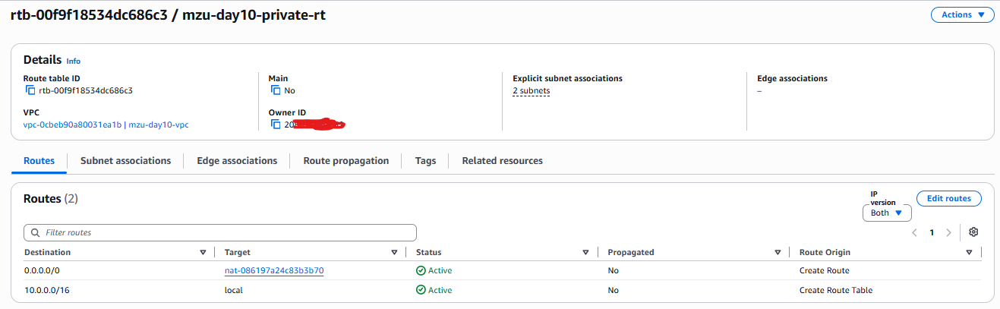
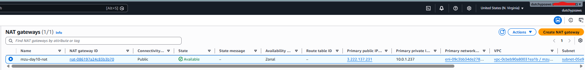

# Terraform AWS Networking — MZ-UCA Day 10

# Project Overview

This project demonstrates the deployment of a multi-tier AWS network using Terraform. The infrastructure includes public and private
subnet tiers, controlled routing, an Internet Gateway, and NAT-based outbound connectivity for private resources.

# Architecture

AWS VPC — 10.0.0.0/16
│
├── Public Subnet A — 10.0.1.0/24
├── Public Subnet B — 10.0.2.0/24
│
├── Private Subnet A — 10.0.11.0/24
├── Private Subnet B — 10.0.12.0/24
│
├── Internet Gateway
├── Public Route Table
│ └── 0.0.0.0/0 -> Internet Gateway
│
├── NAT Gateway
│
└── Private Route Table
└── 0.0.0.0/0 -> NAT Gateway

# Technologies Used

Terraform • AWS • AWS CLI • Visual Studio Code • Git • GitHub

# AWS Resources Created

VPC • two public subnets • two private subnets • Internet Gateway • Elastic IP • NAT Gateway • public route table • private route
table • route-table associations

# Network Design

Public tier: the public subnets use a route table with a default route to the Internet Gateway.
Private tier: the private subnets have no direct route to the Internet Gateway; outbound traffic uses the NAT Gateway.

# Terraform Workflow

terraform init
terraform fmt
terraform validate
terraform plan -out=tfplan
terraform apply tfplan
terraform output
terraform state list
terraform destroy

# Evidence (embedded screenshots)

)

# Key Learning Outcomes

Infrastructure as Code • AWS VPC design • CIDR planning • public and private subnet design • Internet Gateway routing • NAT
Gateway routing • Terraform resource dependencies • state inspection • infrastructure validation • infrastructure documentation

# Security Notes

No AWS credentials or secrets are stored in this repository. Terraform state files and local Terraform working directories are excluded
from Git.

# Cleanup

terraform destroy

# Author
Cloud Engineering Njabulo Khumalo — MZ-UCA Cloud Academy

